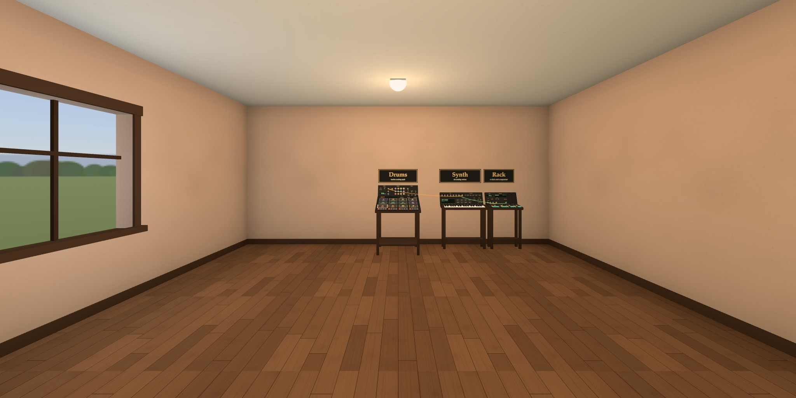

# instruments

**https://ariamokr.github.io/instruments/**

A room of instruments behind the [Hallway](https://ariamokr.github.io/hallway/)'s door. The first is
a drum board against the far wall: twelve analog drums, synthesized in the browser as they are
played, each with its knobs, and a little modular panel: a clock that steps a sixteen-step pattern
for each pad, and a delay, patched with cables (below, "The drums"). Beside it stands a synth: six
analog voices, poly or mono, with thirty-seven keys, twenty-five knobs, eight sounds to start from,
an arpeggiator, and a patch bay of its own, cabled to the board's (below, "The synth"). Beside that
stands its rack, a case of modules: a clock, a sixteen-step sequencer that plays the synth in time
with the drums, a delay of its own, an LFO in time with the clock and an envelope started by the
clock or by notes, both to patch into the synth, and over them a mixer of four sounds into one, a
filter to put any sound through and a plate reverb (below, "The rack"). To the left of the board
stands a keyboard of sixty-one keys with two sounds, an organ with nine drawbars and a rotary
speaker, and an electric piano, or both at once, with jacks of its own: its sound, its notes for the
synth to play along, and its rotary speaker's speed (below, "The keyboard"). Along the right wall,
beside the rack, an electric guitar lies on its desk, to pluck, strum and fret as a guitarist does:
its six strings modelled as they are played, heard through its pickups, four pedals (a wah, an
overdrive, a chorus and a tremolo) and its amp, with jacks of its own: its sound, its notes for the
synth to play along, its wah to move and the clock to strum it (below, "The guitar"). More modules
come in time. The room is the one
[AriaMoKr/RoomTemplateEmpty](https://github.com/AriaMoKr/RoomTemplateEmpty) makes: a floor, four
walls, a ceiling with its lamps, a window onto the afternoon sky, and the doorway back to the
Hallway. It has a rehearsal room's colours, a dark wooden floor and warm clay walls, and is a little
larger than the template, 7 by 8 metres, to leave room for the instruments and the players round
them. Walk it and play in VR on a Meta Quest, on a desktop or on a phone. There is nothing to
install.



Behind you as you come in is the doorway you came through, glowing teal, with the Hallway seen
through it. Walk back through it (or click or tap it, or point at it in VR and pull the trigger) and
you are back in the Hallway, in front of this room's door. Beside it, on the wall, is the control
panel.

## The drums

Against the far wall, under a sign that says **Drums**, stands a board of twelve pads in three rows,
with a row of sixteen step keys in front of them, behind them a strip with the name of the pad last
played and its three knobs, and at the back a panel leaning towards you, with the clock, the drums'
jacks and the delay (below, "The clock, the pattern and the cables"). Choose the board or its sign
(click or tap it, point at it in VR and pull the trigger, or put the dot on it and press A or OK)
and you walk up to it to play. On a screen the view comes down over the board, clear of the card,
and the hint says how to play it.

| | Play a pad | Turn a knob | Step away |
|---|---|---|---|
| Desktop | click it (it sounds as the button goes down), or its key: 1–4, Q–R and A–F, the board's rows from the far one, wherever those keys are on your keyboard's layout; Shift plays harder | drag it up or down, or scroll over it | Esc, or walk off |
| Phone | tap it, with as many fingers at once as you like | drag it up or down | tap the floor |
| Headset | hit it with a stick (a hand holding a controller has one near the board) or a forefinger, as hard as it comes down | point at it and push the stick up or down | walk off |
| Gamepad | the dot on it and A | in the card | B |
| TV remote | the arrows choose a pad, OK plays it | in the card: Menu goes to them | Back |
| MIDI drum pad | General MIDI's drum notes on channel 10, the drums' (on any channel while you play at the board): a pad controller's first bank, 36–51, plays all but the cowbell, 56 | | |

| | Set a step | Start or stop the clock | Patch a cable |
|---|---|---|---|
| Desktop | click its key | click RUN, or Space | click a jack, then another; Esc puts the cable away |
| Phone | tap its key | tap RUN | tap a jack, then another |
| Headset | hit its key with a stick or a forefinger, or point at it and pull the trigger | point at RUN and pull the trigger | point at a jack and pull the trigger, then at another; the trigger anywhere else puts the cable away |
| Gamepad | the dot on it and A | the dot on RUN and A | the dot on a jack and A, then on another; B puts the cable away |
| TV remote | in the card: Menu goes to the steps | play/pause | in the card |

A keyboard's play/pause key starts and stops the clock too, anywhere on the page. While you carry a
cable, the controls of the instrument you play still play, a jack on the synth, the rack or the keys
takes it as one on the board does, choosing another instrument walks you over with it, and choosing
anything else puts it away.

The card's **Drums** has the same twelve pads as buttons, each with its key, the clock, the steps
and the knobs of the pad last played (**As it comes** sets the knobs back), the delay and the cables
(below). On a TV it opens when you walk up to play, and the board stands beside it. The card's
**Sound** has the volume and **Mute**, over every instrument, and where the browser has Web MIDI
(Chrome, Edge and Firefox on a computer or an Android phone; not Safari, nor the Quest's browser),
**Play from a MIDI device**, which asks for the devices plugged in; once you have said yes, the room
listens to them on every visit, on every channel, and to any plugged in later. The knobs are kept
for the next visit (`localStorage`, `instruments.drums`), as are the volume and mute
(`instruments.sound`). What each instrument keeps is written a moment after its last change, and at
once when the page is left, closed or hidden, so a knob turned just before leaving is kept too.

Every sound is made in the browser as it is played (Web Audio), the way the drum machines of the
early 1980s made theirs, so there are no samples to download or credit: a sine whose pitch falls
for the kick and the toms, noise through filters for the snare and the clap, six square waves at
clashing pitches through filters for the hi-hats and the cymbals (the 808's), and two for the
cowbell. The knobs are those machines' too: pitch, decay and tone, the middle the drum as it comes.
A drum played again cuts its last note short, as a machine's one circuit for each drum does, and the
two hi-hats share one, so the closed one stops the open one ringing.

A pad sounds in the event that plays it (the key, the press, the stick, the MIDI note), at the audio
clock's current time, with no scheduler in between (the pattern's steps are set ahead instead:
below): what you wait for is the device's own output
latency (`latencyHint: 'interactive'`), measured on a desktop at 10 ms in the browser and 32 ms on to
the speakers. Many hits at once bend in a soft clipper rather than crackle (a WaveShaper: no
look-ahead to wait on), and at most 32 notes sound at once. Browsers play sound only after a click,
a tap or a key on the page, so the first one starts it; a MIDI note before then asks for one. On an
iPhone the page plays as a media player does (`navigator.audioSession.type = 'playback'`), which the
silent switch doesn't mute. With less motion, the walk up to the board is a jump and the pads light
up more softly.

### The clock, the pattern and the cables

The panel at the back of the board has a module in each of its three sections, as a modular synth
has, with jacks to patch them together:

- **Clock**: **RUN** starts and stops it (it never runs by itself, nor when you come back), **TEMPO**
  sets its pace from 60 to 180 beats a minute, shown on its display, and its outputs send a pulse
  every step (**×1**), every 2nd (**÷2**) or every 4th (**÷4**). A step is a 16th note, so sixteen
  are a bar. RUN's light beats with it.
- **Drums**: **CLOCK**, the input that steps the pattern on each pulse that comes in, and an output
  for each pad's sound, laid out as the pads are.
- **Delay**: **IN**, and its knobs: **TIME**, from 1 to 8 steps of the clock (so its echoes fall on
  the beat and follow the tempo), **FEEDBACK**, how long they go on, and **LEVEL**. A pad patched
  into it is still heard as it was, with its echoes after it.

The pattern is sixteen steps for each pad. The step keys show the steps of the pad last played, in
its colour, with the step playing lit, and pressing one sets it or clears it. The room comes with
the clock's ×1 patched into the drums and a beat to start from: the kick on every beat, the snare on
two and four, and the closed hat on every 8th.

A cable goes from an output to an input of its kind: the clock's pulses (in amber), a pad's sound
(in the pad's colour), the synth's (in blue), the keyboard's (in red), the guitar's (in copper),
the rack's filter's (in violet), an LFO or the synth's envelope (in pink: below, "Its patch bay" and
"The rack"), or notes, the sequencer's, the keyboard's or the guitar's (in green: below, "The rack"
and "Its jacks"). Take one from a jack, on the board, the synth, the rack, the keyboard or the
guitar, and it follows where you point until you
plug it into another, on any of them; the jack you point at is ringed in gold, or in grey where it
can't go, and a message says why: a clock into a sound's input, say, or a sound back round into
where it came from (the filter's out into its own in). An input takes one cable: taking it from the
input pulls it out, still in its output, to plug in elsewhere or put away, and plugging a new one
into an input pulls the old one out. An output feeds any number.

In the card, **Drums** has the same: **Clock** (Start or Stop, and the tempo), **Steps** (the
sixteen of the pad last played as toggles, the step playing marked, **Clear**, and **Beat as it
comes** for every pad), **Delay** (its three knobs, and **Delay as it comes**) and **Cables** (for
each input, the output plugged into it, or nothing). The tempo, the pattern, the delay's knobs and
the cables are kept for the next visit (`instruments.clock`, `instruments.pattern`,
`instruments.delay` and `instruments.patch`).

The clock keeps time by the audio clock, not by a timer: each step's notes are set up to 120 ms
ahead to start exactly on it, from the frame loop and from a timer every 25 ms (a slow frame, or no
3D view, moves no note), and what a step shows (the step lit, the pads, RUN's light) waits until it
is heard. A step that fell too far behind while the page stalled is skipped rather than played late.

## The synth

To the right of the board, under a sign that says **Synth**, stands a synth with six analog voices:
thirty-seven keys along its front, from C3 to C6 to start with, its twenty-five knobs behind them in
two rows, and at the back a panel: along its top the patch bay's jacks and the arpeggiator (below,
"Its patch bay and its arpeggiator"), and under them its display (the sound, Mono or poly, the keys'
octave, the arpeggiator, and the knob turned last), the eight presets' buttons, **MONO**, and the
octave's **−** and **+**. Choose it or its sign, as the board, and you walk up to play; on a screen
the view comes down over it, clear of the card and of the board.

| | Play a key | Turn a knob | A button on its panel | Step away |
|---|---|---|---|---|
| Desktop | click it and hold (drag along the keys to slide from one to the next), or its key: the row from A plays the white keys from middle C, the row above (W, E, T, Y, U, O, P) the black ones; Shift plays harder | drag it up or down, or scroll over it | click it; Z and X: an octave down and up | Esc, or walk off |
| Phone | touch it and hold, with as many fingers as you like, and slide along them | drag it up or down | tap its button | tap the floor |
| Headset | press it down with a stick (it shows near the synth too) or a forefinger, as hard as you like, and slide along them; or point at it and pull the trigger | point at it and push the stick up or down | point at it and pull the trigger | walk off |
| Gamepad | the dot on it and A | in the card | the dot on it and A | B |
| TV remote | the arrows choose a key (up and down an octave), OK plays it | in the card: Menu goes to its sounds | in the card | Back |
| MIDI keyboard | any channel but 10, the drums' (all of them go to the drums while you play at the board); its sustain pedal, its mod wheel (vibrato) and its pitch bend (two semitones) too | | | |

A key held sounds until it is let go; a click, A, OK or a trigger plays it a moment. In **poly** each
key has a voice of its own, six at most (a seventh takes the voice held longest), each voice's filter
a little apart from the others', as an analog synth's are. In **mono** the last key held sounds, on
all six voices spread by **DETUNE** into one thick note (on one, with no detune), and a key pressed
while another is held glides to it (**GLIDE**) without starting again, as does letting it go back to
one still held.

The knobs are in sections, as on its top:

- **Oscillator**: the levels of the **SAW**, the **PULSE** (its **WIDTH**), the **SUB** an octave
  down and **NOISE**, and **DETUNE**, the voices apart (in mono, how thick).
- **LFO**: its **RATE**, and how much it moves the pitch (**VIBRATO**, the mod wheel too), the
  filter (**WAH**) and the pulse's width (**PWM**).
- **Filter**: a 24 dB low-pass, its **CUTOFF**, **RESO** (resonance) and **ENV**, how far its
  envelope opens it.
- **Filter envelope** and **Amp envelope**: **A**, **D**, **S** and **R** each.
- **Output**: **GLIDE** (in mono), **DRIVE** into a soft clip, **CHORUS**, and the **LEVEL**.

The presets are four poly sounds (**Pad**, **Strings**, **Brass**, **Pluck**) and four mono ones
(**Fat Bass**, **Acid**, **Wobble**, **Sweep**). A knob turned after one is a change, said on the
display; choosing that preset again brings it back as it comes. The knobs, Mono, the preset, the
octave and the arpeggiator are kept for the next visit (`instruments.synth`), and its cables with
the board's (`instruments.patch`).

The card's **Synth** has the same: its keys as buttons (each sounds while it is pressed; one stop
among them for a keyboard, the arrows, Home and End going along them; not on a TV, where the remote
plays the synth's own), the presets, **Mono**, **As it comes** and the octave, **Arpeggiator** (off
or one of its ways, **Hold** and **Range**), its knobs as sliders, a section each, and **Cables**
(for each of its inputs, the output plugged into it, or nothing; its sound is one of the choices
for either delay's in, under **Drums** and **Rack**, and for the mixer's, the filter's and the
reverb's, under **Rack**, and its LFO and its envelope for the filter's **Cutoff in**, under
**Rack**, and the keyboard's **Rotary speed in**, under **Keys**). Its sound is made as the drums' are, in the
browser as it is played, and goes out through **Sound**'s volume with the drums.

### Its patch bay and its arpeggiator

Along the top of the synth's panel, as on a semi-modular synth, are its jacks and its arpeggiator,
cabled as the board's are (above, "The clock, the pattern and the cables"):

- **Patch**: its outputs, **OUT** (its sound: into either delay's **IN**, on the board or the rack,
  it is still heard as it was, with its echoes after it; into the rack's filter, it is heard through
  it), **LFO** (the triangle its **RATE** sets) and **ENV** (the filter envelope, each voice its own,
  as its knobs shape it; into the keyboard's **ROTARY** or the rack's filter's **CUTOFF**, the
  latest note's), and its inputs, which either of those moves, or the rack's LFO or its envelope
  (below, "The rack"): **PITCH** (by up to an octave), **CUTOFF** (up to three octaves) and **AMP**
  (with a cable in it the voices sit at half and swing from there: an LFO a tremolo, an envelope a
  second shape). Nothing is patched into them as it comes.
- **Arpeggiator**: its **CLOCK** input, the room's clock's ×1 as it comes (a note a step; ÷2 and ÷4
  slower), and its buttons. **UP**, **DOWN**, **UP+DN** (the top and the bottom once each way) and
  **RAND** play the keys held one at a time in that order, as the poly synths of the early 1980s
  did, each as hard as its key went down; the way lit, pressed again, turns it off. **HOLD** keeps
  the chord after the keys are let go, until a key goes down with none held, which starts a new
  one; a key chosen with A, OK or a trigger (or Enter in the card) brings its note into the chord,
  or takes it out.
  **RANGE** plays the chord over one, two or three octaves. While the clock isn't running, or
  nothing is patched into CLOCK, it keeps its own time, 16ths at the clock's tempo, the first note
  at once. The display says what it plays, and its way and HOLD are lit.
- **NOTES**: the input a sequencer plays it through (below, "The rack"), the rack's as it comes; or
  the keyboard's notes, for it to play along (below, "Its jacks").

## The rack

To the right of the synth, under a sign that says **Rack**, stands a case of modules, as deep as the
synth and in line with it. On its top is the sequencer's line, sixteen steps in fours as the drum
board's step keys are, each with its number, its key (lit where the step plays its note, dark where
it rests), its **ACCENT** key (played harder: louder, its filter opened more), its **SLIDE** key
(held on into the next step, gliding to its note without starting again), its note's name, and the
knob that sets the note, over two octaves from the line's lowest. On the panel are its modules side
by side in two rows, as in a case of two. In the first:

- **Clock**: the room's clock again, nearer the synth: **RUN**, **TEMPO** and its display, and its
  outputs **×1**, **÷2** and **÷4**, sending the same pulses as the board's.
- **Sequencer**: its display (its octave, and what was set last), the octave's **−** and **+**, its
  **CLOCK** input, which moves it on a step for each pulse that comes in, and its **NOTES** output,
  into the synth's **NOTES** input.
- **Delay**: the rack's own, a second loop as the board's is (above, "The clock, the pattern and the
  cables"): **TIME** in steps of the clock, **FEEDBACK** and **LEVEL**, each knob's setting written
  under it, and its **IN**, for a pad's sound, the synth's, the keyboard's, the mixer's or the
  filter's.
- **LFO**: a slow wave in time with the clock, for the synth's **PITCH**, **CUTOFF** or **AMP**, the
  keyboard's **ROTARY**, or the filter's **CUTOFF**. **RATE** is a note value, from four bars to a
  16th, so that its cycles fall on the beat at any tempo and start again with the clock; **SHAPE** a
  sine, a triangle, a saw (falling), a square or random (a new value each cycle, held); **DEPTH** how
  far it moves what it is patched into. Its light, by its name, shows the wave, and its output is
  **OUT**. While the clock is stopped it goes on at the tempo by itself.
- **Envelope**: a shape for the same inputs as the LFO's wave, but started: by each pulse into its
  **CLOCK** input (held for half its step), or by each note into its **NOTES** input, the
  sequencer's or the keyboard's (as high as the note is played hard, an accent higher, and held as
  long as the note is; a step that slides carries it on into the next without starting it again).
  From nothing it rises over **A** (attack) to its top, falls over **D** (decay) to **S** (sustain,
  a share of its top) while it is held, and back to nothing over **R** (release) once it is let go;
  started again before it has fallen, it rises from where it is. **DEPTH** is how far it moves what
  it is patched into. Its light, by its name, shows the shape, and its output is **OUT**.

In the second, over the first, a blank plate (over the envelope) where more modules will go, and:

- **Mixer**: four sounds into one. A pad's, the synth's, the keyboard's or the filter's patched into
  one of its **IN 1** to **IN 4** no longer goes straight out, but through it, as loud as the knob
  over that in says (as loud as it came three quarters of the way round, 5 dB louder at the top),
  out of its **OUT** with the rest: heard, and for either delay's **IN**, the filter's or the
  reverb's, so that several sounds go through the filter, or into a delay, on one cable.
- **Filter**: a resonant filter for any sound. A pad's, the synth's, the keyboard's or the mixer's
  patched into its **IN** no longer goes straight out, but through it and out of its **OUT**: heard,
  and for either delay's **IN**, the mixer's or the reverb's. **MODE** turns it from a low-pass
  (**LP**, the highs taken away) to a band-pass (**BP**, only a band round the cutoff) and a
  high-pass (**HP**, the lows taken away); **CUTOFF** sets where, from 30 Hz to 17.6 kHz; **RES** how
  much it rings there (a band-pass's band narrower); and **MOD** how far its **CUTOFF** input moves
  the cutoff, up to four octaves, for an LFO's wave or an envelope (the synth's filter envelope, or
  the rack's). Its OUT can't go back into its own IN, nor into the mixer while the mixer goes
  through it: no sound can go round.
- **Reverb**: a plate's. A sound patched into its **IN** is still heard as it was, with the reverb
  after it. **SIZE** is how long it rings, from a third of a second to nearly five; **DAMP** how much
  sooner its highs die away than its lows; **LEVEL** how loud it is.

The room comes with the rack's ×1 patched into the sequencer and the sequencer's notes into the
synth, and a bass line in C minor to start from, so RUN plays the drums and the line together. The
synth plays it in the sound it has; **Acid** and **Fat Bass**, both mono, suit a line like it.
Nothing is patched into the delay, the envelope, the mixer, the filter or the reverb, or out of the
LFO, as it comes: the LFO's **OUT** into the synth's **CUTOFF**, at a quarter note, makes the line
wah on the beat; a pad through the filter, a high-pass the LFO sweeps, thins out and fills again in
time; the synth through the filter, with the sequencer's notes into the envelope too and its OUT
into the filter's **CUTOFF**, opens the filter with each note of the line, the accents wider; the
drums and the keyboard's organ into the mixer, and it into the reverb, ring as in a hall together.

| | Set a step | Its accent, its slide | Its note | Start or stop the clock |
|---|---|---|---|---|
| Desktop | click its key, or its key on the keyboard: 1–8 and Q–I | click its key; Shift with a step's key, its accent | drag its knob up or down, or scroll over it; Z and X: the octave down and up | click RUN, or Space |
| Phone | tap its key | tap its key | drag its knob up or down | tap RUN |
| Headset | hit its key with a stick or a forefinger, or point at it and pull the trigger | the same | point at its knob and push the stick up or down | point at RUN and pull the trigger |
| Gamepad | the dot on it and A | the dot on it and A | in the card | the dot on RUN and A |
| TV remote | the arrows choose a step (left and right), OK sets it or rests it | in the card: Menu goes to the steps | up and down, a semitone at a time | play/pause |

The modules' knobs turn as a step's note's knob does (with a gamepad or a remote, in the card). A note set while the clock is stopped sounds on the synth a moment (while the sequencer
is patched into it), to find it by ear. While the clock runs, the step playing is lit on the rack and marked in
the card, and the synth's keys show the note it plays. Its notes are set ahead on the audio clock as
the drums' are, each sounding for half its step, or held on into the next when it slides; stopping
the clock, or pulling out either cable, lets a note held on go.

The card's **Rack** has the same: **Clock** (Start or Stop, and the tempo), **Sequencer** (a row for
each step: its number, pressed where it plays; its note, a choice of the knob's twenty-five; **Accent**
and **Slide**; then **Octave**, **Clear** and **Line as it comes**), **Delay** (its three knobs,
and **Delay as it comes**), **LFO** (its rate and its shape, each a slider along its knob's places,
its depth, and **LFO as it comes**), **Envelope** (its attack, decay, sustain, release and depth,
and **Envelope as it comes**), **Mixer** (a level for each of its four ins, and **Mixer as it
comes**), **Filter** (its mode a slider along its three, its cutoff, its resonance and its mod, and
**Filter as it comes**), **Reverb** (its size, its damping and its level, and **Reverb as it
comes**) and **Cables** (the sequencer's clock in, the delay's in, the envelope's clock in and notes
in, the mixer's four ins, the filter's in and cutoff in, and the reverb's in; the mixer's out and
the filter's are choices for the delays' ins, the reverb's and each other's, but not their own; the
sequencer's notes out is a choice for the synth's **Notes in**, and the LFO's out and the
envelope's for its **Pitch in**, **Cutoff in** and **Amp in**, under **Synth**, and for the
keyboard's **Rotary speed in**, under **Keys**). The line and its octave are kept for the next visit
(`instruments.seq`), the modules' knobs too (`instruments.rackdelay`, `instruments.lfo`,
`instruments.envelope`, `instruments.mixer`, `instruments.filter` and `instruments.reverb`), and the
rack's cables with the rest (`instruments.patch`).

## The keyboard

To the left of the board, under a sign that says **Keys**, stands a stage keyboard with two sounds,
an organ and an electric piano, or both at once: sixty-one keys along its front, from C2 to C7;
behind them the organ's nine drawbars and the knobs of both, a section each; and at the back a panel
with its display (the sound, the drawbars as an organist writes them, the percussion, the rotary
speaker, the octave, and the knob turned last), the sounds' buttons (**ORGAN**, **E.PIANO**,
**BOTH**), the percussion's (**PERC**, **3RD**, **FAST**), the rotary speaker's **FAST**,
**SUSTAIN**, the octave's **−** and **+**, and at its right, nearest the board, its jacks (below,
"Its jacks"). Choose it or its sign, as the board, and you walk up to play; on a screen the view
comes down over it, clear of the card and of the board (on a phone held upright, over the two
octaves from C3).

| | Play a key | Pull a drawbar, turn a knob | A button on its panel | Step away |
|---|---|---|---|---|
| Desktop | click it and hold (drag along the keys to slide from one to the next), or its key, as the synth's: the row from A plays the white keys from middle C, the row above the black ones; Shift plays harder; Z and X: an octave down and up | drag a drawbar's tab out or in, or click along its slot; drag a knob up or down; or scroll over either | click it | Esc, or walk off |
| Phone | touch it and hold, with as many fingers as you like, and slide along them | drag it | tap it | tap the floor |
| Headset | press it down with a stick (it shows near the keyboard too) or a forefinger, as hard as you like, and slide along them; or point at it and pull the trigger | point along a drawbar's slot and pull the trigger; point at either and push the stick up or down | point at it and pull the trigger | walk off |
| Gamepad | the dot on it and A | the dot along a drawbar's slot and A; the knobs in the card | the dot on it and A | B |
| TV remote | the arrows choose a key (up and down an octave), OK plays it | in the card: Menu goes to its sounds | in the card | Back |
| MIDI keyboard | any channel but 10, the drums', while you play at the keys (elsewhere they play the synth); its sustain pedal too | | | |

A key held sounds until it is let go; a click, A, OK or a trigger plays it a moment. With
**SUSTAIN** lit, or a MIDI keyboard's sustain pedal down, the notes let go ring on until it is let
go too. Each sound plays sixteen notes at once at most (a seventeenth cuts the oldest short).

The **organ** is made as the tonewheel organs of the 1950s and 60s made theirs. A key plays nine sine
waves at once, one a drawbar: **16′** an octave under the note, **5⅓′** a fifth over that, **8′** the
note, then **4′**, **2⅔′**, **2′**, **1⅗′**, **1⅓′** and **1′**, three octaves over it, each pulled
out from 0 (pushed in) to 8, 3 dB louder a step. An organist writes them as they lie, in groups:
88 8000 000, a jazz organ's, is the keyboard's as it comes, and the display and the card say them so.
**PERC** strikes the second harmonic (with **3RD**, the third) as a key goes down, dying away slowly
(with **FAST**, fast), on the first key of a phrase only (one pressed while none is held), as on the
organs it comes from. Its knobs:

- **CHORUS**: the scanner's vibrato, a short delay swaying six or seven times a second, beside the
  sound as it was (off at 0).
- **CLICK**: the click of a key's contacts as they close and open.
- **DRIVE**: its amplifier driven into a soft clip.
- **ROTARY**: how much goes through the rotary speaker, a horn for the highs and a drum for the lows
  going round, slowly or (with the **FAST** under **ROTARY**) fast, each speeding up and slowing
  down at its own pace, so that on each side the sound comes and goes and its pitch rises and falls.
- **LEVEL**: how loud it is.

An organ isn't played harder or softer, so every key is as loud, Shift or not.

The **electric piano** is a tine piano of the 1970s, made by FM as the digital pianos of the 1980s
made theirs: a sine at the note whose pitch another moves, the more the harder a key is struck (so it
barks), dying back to a purer tone, with the tine's short ring over it. Harder keys are louder; held,
a note dies away over seconds, lower notes more slowly; let go, a damper stops it. Its knobs:

- **TONE**: how bright it is.
- **BARK**: how much brighter a harder strike makes it.
- **DECAY**: how long a note held rings (middle C, from about two seconds to half a minute).
- **TREMOLO** and **RATE**: how far it pans from side to side, and how fast (1.5 to 9 times a
  second).
- **LEVEL**: how loud it is.

**BOTH** plays the two at once, each as its knobs set it. The card's **Keys** has the same: its keys as
buttons (as the synth's: each sounds while it is pressed, one stop among them; not on a TV), its
**Sound** (**Organ**, **Electric piano** or **Both**, **Sustain**, **As it comes**, and the octave the
computer's keys play in), **Drawbars** (sliders in eighths, the drawbars as an organist writes them
over them), **Percussion** (**Percussion**, **Third harmonic**, **Fast decay**), the organ's knobs
(with **Rotary speaker fast**) and the electric piano's as sliders, and **Cables** (below). The
drawbars, the knobs, the switches, the sound and the octave are kept for the next visit
(`instruments.keys`), and its cables with the rest (`instruments.patch`). Its sound goes out through
**Sound**'s volume with the rest, and is made in the browser as it is played: nothing to download.

### Its jacks

At the right of its panel, under **PATCH**, are its jacks, cabled as the board's are (above, "The
clock, the pattern and the cables"):

- **OUT**: its sound, as it is heard, into either delay's **IN**, on the board or the rack, or the
  rack's reverb's: it is still heard as it was, with its echoes or the reverb after it; into the
  rack's mixer or its filter, it is heard through it.
- **NOTES**: the keys played, into the synth's **NOTES** input in the sequencer's place, so that the
  synth plays along with it, layered: at the same pitch, in the synth's own sound, poly or mono, as
  hard as each key went down, each note held as long as the keyboard holds it (**SUSTAIN** too), and
  with the arpeggiator on, the keys held arpeggiated (with **HOLD** lit, a key clicked goes into its
  chord, or out of it, as on the synth's own keys). A MIDI keyboard played at the keys plays it too.
  Pulling the cable out lets go of the notes it holds. Into the rack's envelope's **NOTES** instead,
  or as well, each key starts the envelope, held while any is down.
- **ROTARY**: the rotary speaker's speed, moved by what comes in from where **FAST** sets it,
  between slow and fast: with FAST off, what comes in speeds the horn and the drum up as it rises
  (an LFO over the top half of its wave, an envelope with each note), and with FAST
  lit, what falls below nothing slows them down. They follow it at their own pace, as they do FAST:
  a square from the rack's LFO at full depth, a bar or two long, switches between slow and fast in
  time with the music.

Nothing is patched into them as it comes. In the card, **Keys** has **Cables** with the **Rotary
speed in**; its sound is a choice for either delay's in, under **Drums** and **Rack**, and for the
mixer's, the filter's and the reverb's, under **Rack**, and its notes for the synth's **Notes in**,
under **Synth**, and the envelope's, under **Rack**.

## The guitar

Along the right wall, beside the rack, under a sign that says **Guitar**, an electric guitar lies on
its back on a desk turned to face into the room: its neck to your left and its low E string nearest
you, as a guitar you hold looks when you look down at it. Behind its neck are sixteen chord buttons
in two rows, as their keys lie on a computer's keyboard (**E**, **A**, **D**, **G**, **C**, **F**,
**Em** and **Am** under 1 to 8, the far row; **Dm**, **Bm**, **E7**, **A7**, **D7**, **B7**, **E5**
and **A5** under Q to I), the chord chosen lit; on its body its **VOLUME** and **TONE** knobs and its
pickup switch (**NECK**, **BOTH**, **BRIDGE**); and at the back a panel with its jacks under
**PATCH**, its display (the chord, the pickup, how the amp sounds, the pedals on, and the knob turned
last), its amp's knobs (**GAIN**, **BASS**, **MIDDLE**, **TREBLE**, **MASTER**) and its four pedals
(**WAH**, **OVERDRIVE**, **CHORUS**, **TREMOLO**), each with its knob, its light and its footswitch.
Choose it or its sign, as the board, and you walk up to play; on a screen the view comes down over
it, clear of the card; in VR you are taken to its neck's end, turned to face it.

| | Strum or pluck | Fret a string | Choose a chord | A knob, the pickup switch, a pedal | Step away |
|---|---|---|---|---|---|
| Desktop | drag across the strings over the body (away from you a down strum, towards you an up one), or press one there; or the keys: Z to N pluck a string each, the low E to the high E, the arrows down and up strum down and up, Shift plays harder; M, or a click on the bridge, mutes them | press a string on the neck at a fret and hold; drag along the neck to slide, across the string to bend it | click its button, or its key, 1–8 and Q–I; the arrows left and right: the chord before or after | drag a knob up or down, or scroll over it; click the switch where you want it; click a pedal (under its knob) to switch it on or off | Esc, or walk off |
| Phone | swipe across the strings over the body, or touch one there | touch a string on the neck and hold, and slide (with as many fingers as you like: one fretting while another strums) | tap it | drag a knob; tap the switch; tap a pedal | tap the floor |
| Headset | sweep a stick's tip (they show near the guitar too) or a forefinger across the strings over the body, as fast and as hard as you like; or point at one there and pull the trigger; a tip down on the bridge mutes them | press a string on the neck down with a tip, and move it along or across; lift it to let go; or point at it and pull the trigger | a tip down on its button, or point at it and pull the trigger | point at a knob and push the stick up or down; point at the switch or a pedal and pull the trigger | walk off |
| Gamepad | the dot on a string over the body and A | the dot on a string on the neck and A | the dot on its button and A | the dot on the switch or a pedal and A; the knobs in the card | B |
| TV remote | OK or down strums down, up strums up | | left and right | in the card: Menu goes to its chords | Back |
| MIDI keyboard | | any channel but 10, the drums', while you play at the guitar: each note on a string (below) | | | |

A chord frets the strings it fingers and mutes the ones it leaves out (struck, they thud), and the
strings' keys, a sweep over them and the arrows play what it frets; with none chosen the strings are
open. A string pressed on the neck plays at that fret instead, ringing on as it is slid along the
neck to another fret or bent across it, up to a whole tone; let go, the finger lifting mutes it, and
the chord frets it again. Choosing another chord moves the fingers, muting the strings they move on,
and choosing the chord chosen again lets go of it. A click, A, OK or a trigger on a string over the
neck presses it there a moment. A sweep plucks each string it crosses as hard as it goes fast; a
strum goes from the low E to the high E (up, from the high E, the low strings less), faster the
harder. Every string rings until it dies away or is muted, all six at once, and one plucked again
stops ringing as the pick meets it. A MIDI keyboard played at the guitar plays its strings: each note
on the free string where it falls lowest on the neck (where none is free, the string of the note
held longest), pressed at that fret and plucked, and let go with the key; one the guitar can't reach
an octave up or down.

Its strings are modelled as they are plucked, as Karplus and Strong made theirs and Jaffe and Smith
extended it, so there are no samples: a pluck puts the pick's push into a loop one period of the
note long, its harmonics falling away as a plucked string's do, those with a node where the pick
meets it left out (nearer the bridge, thinner), with a little of the pick's scrape, brighter the
harder it is plucked; each time round, the string loses a little, more of its
highs, so it rings on at its note, its brightness dying first (open, the low E for seven seconds,
the high E for three and a half). Its two pickups hear the strings where they lie, as a guitar's
magnets do: **NECK**, a quarter of the way from the bridge, round and full; **BRIDGE**, near it,
thinner and brighter; **BOTH**, the two at once. Its knobs:

- **VOLUME**: how much of it goes into the amp, so that turned down it drives the amp less.
- **TONE**: the pickups' resonance, a peak at 5 kHz full up, darker down to 1 kHz with none.

Its amp's knobs:

- **GAIN**: how hard the guitar drives its valve, clean (up to a third), then crunch, then lead
  (from two thirds), its curve clipping the tops of the wave a little sooner than the bottoms, as a
  valve does.
- **BASS**, **MIDDLE** and **TREBLE**: its tone stack, each 12 dB up or down, at 120 Hz, 650 Hz and
  2.6 kHz.
- **MASTER**: how loud it is.

Then a 12-inch speaker cabinet's sound: no deep lows, a thump, a bite, and nothing much over 5 kHz.
The strings are worked out on the audio thread (an AudioWorklet), which a browser has only on a page
served securely, as GitHub Pages and `localhost` are; where it has none, a toast says it can't play
them.

Its pedals stand in the order its sound goes through them, as a guitarist lays them out: the wah and
the overdrive before the amp, the chorus and the tremolo after it, as in an amp's effects loop. Each
is switched on or off by its footswitch, its light red while it is on (a toast says which), and
each has a knob:

- **WAH**: most of the guitar through a narrow band, its **PEDAL** sweeping it from heel down
  (350 Hz, dark) to toe down (2.4 kHz, bright), with a little of the guitar beside it.
- **OVERDRIVE**: the guitar clipped by its **DRIVE** (3 to 36 dB), all but its lows, which go by
  beside it clean, as a Tube Screamer does, rolled off over 3.2 kHz: the amp driven harder, fuller in
  the middle.
- **CHORUS**: two short delays beside the guitar, one each side, swaying opposite ways at its
  **RATE** (0.15 to 4.5 times a second), so that it sounds wider, as though doubled.
- **TREMOLO**: its volume beating at its **SPEED** (1.5 to 10 times a second).

As it comes, all four are off.

The card's **Guitar** has the same: **Play at the guitar**; **Chord** (**Open strings** and the
sixteen chords, each with its key, then **Strum down**, **Strum up** and **Mute strings**);
**Strings**, each string's frets from 0 to 12 as buttons, each sounding while it is pressed as a
string pressed on the neck does, marked where the chord or a finger frets it (one stop among them:
the arrows go along a string and across them; not on a TV); **Pickup** (**Neck**, **Both**,
**Bridge**); **Guitar** (**Volume**, **Tone**) and **Amp** (**Gain**, **Bass**, **Middle**,
**Treble**, **Master**) as sliders; **Pedals**, each switched on or off beside its knob (**Wah
pedal**, **Overdrive drive**, **Chorus rate**, **Tremolo speed**); **As it comes**; and **Cables**
(below). The knobs, the pedals, the pickup and the chord are kept for the next visit
(`instruments.guitar`), and its cables with the rest (`instruments.patch`). Its sound goes out
through **Sound**'s volume with the rest.

### Its jacks

At the left of its panel, under **PATCH**, are its jacks, cabled as the board's are (above, "The
clock, the pattern and the cables"), its outs over its ins:

- **OUT**: its sound, after its pedals and its amp, into either delay's **IN**, on the board or the
  rack, or the rack's reverb's: it is still heard as it was, with its echoes or the reverb after it;
  into the rack's mixer or its filter, it is heard through it.
- **NOTES**: the notes as its strings play them, into the synth's **NOTES** input in the sequencer's
  place, so that the synth doubles it, in its own sound, poly or mono: each string's note from its
  pluck until it is muted, plucked again or has died away (to about −30 dB), as hard as it was
  plucked; a string slid to another fret slides the synth's note there, legato (a bend stays the
  guitar's). Pulling the cable out lets go of the notes it holds. Into the rack's envelope's
  **NOTES** instead, or as well, each pluck starts the envelope, held while any string rings.
- **WAH**: a modulation (the rack's LFO or envelope, or the synth's) moving the wah's band from where
  its **PEDAL** sets it, all of its sweep at full depth. The wah must be on to hear it: a toast says
  so when it isn't. With the envelope started by the guitar's own notes, it is an auto-wah: each
  pluck opens it, and it closes as the envelope falls.
- **CLOCK**: a clock's pulses, the board's or the rack's (every step, every 2nd or every 4th),
  strumming the strings as they are fretted, down and up in turn from the clock's start, a down on
  the beat the hardest.

Nothing is patched into them as it comes. In the card, **Guitar** has **Cables** with the **Wah in**
and the **Guitar clock in**; its sound is a choice for either delay's in, under **Drums** and
**Rack**, and for the mixer's, the filter's and the reverb's, under **Rack**, and its notes for the
synth's **Notes in**, under **Synth**, and the envelope's, under **Rack**.

## Moving about

As in the Hallway:

| | Look | Walk | Go back out | Wave (in a shared session) |
|---|---|---|---|---|
| Desktop | drag | WASD or arrows (Shift runs), Q/E or ←/→ turn, click the floor | click the doorway, or walk into it | the **Wave** button |
| Phone | drag | tap the floor | tap the doorway | the **Wave** button |
| Headset | your head | left stick walks (or aims a teleport), right stick turns, trigger at the floor teleports | trigger (or pinch) at the doorway, or step through it | squeeze a grip |
| Gamepad | right stick | left stick (click it in to hurry) | aim the dot at the doorway and press A, or walk into it | the **Wave** button |
| TV remote (below, "On a TV") | ←/→ turn | ↑/↓ | the dot on the doorway and OK, or walk into it; or Back | **Wave** in the card (Menu) |

Whatever hangs on the walls (below, "On the walls") is chosen as the doorway is: you walk up to it,
and on through it when it leads somewhere.

The walls stop you. **Fullscreen** and **Enter VR** are at the bottom right (not on a TV). The **control panel**
by the doorway holds Enter or exit VR, how to move and turn in VR (Smooth or Teleport, Snap or
Smooth), the comfort settings below, and Start or Leave shared session. The card at the top left
(the page's navigation) has the same choices as real controls under **Settings**, for a keyboard or
a screen reader, and **← Hallway** as a plain link. The VR choices are the Hallway's own: both read
and keep them in `localStorage` under `hallway.nav` ([AriaMoKr/common](https://github.com/AriaMoKr/common)'s
`nav.js`), so a choice made on either side of the door holds on the other.

### Settings for comfort

Three settings, on the panel and in the card's **Settings**, are shared the same way, under
`hallway.access` (common's `access.js`): set them anywhere on the site and they hold behind every
door.

| Setting | What it does here |
|---|---|
| **Motion**: System, Less or Full | With less motion (System follows the device's own setting) nothing glides: a click on the floor or the doorway is a jump, not a walk; the fades are blinks; the doorway's veil holds still; a waving visitor doesn't bob; and the page's own transitions stop. |
| **Vignette**: On or Off | In VR, while you glide or turn smoothly with the sticks, the edge of the view darkens and closes in, and opens when you stop. Snap turns and teleports blink instead. |
| **Seated**: On or Off | In VR, your view is raised 0.45 m, so sitting down you see the room from about standing height. |

## Coming in through the Hallway's door

The Hallway opens a door's room with the visit added to its address, by the door contract in
[AriaMoKr/common](https://github.com/AriaMoKr/common)'s README ("Going in", "Linking back"), whose
`door.js` the room reads it with. It reads it once and takes it off the address, so a reload, Back
or a shared link doesn't arrive again; `room` stays.

| Parameter | What the room does with it |
|---|---|
| `from=hallway`, `back`, `backname` | The doorway leads back to `back`, called the Hallway when it is the Hallway's own page (or, developing, when both are on this machine); any other address is named by its host, or by `backname`. Without `back`, it leads to the Hallway anyway, at `?from=instruments`, in front of this room's door. The way back lasts the tab (`sessionStorage`). |
| `dx`, `yaw`, `pitch` | You come in where you went through (`dx` across the doorway), turned and looking as you were. |
| `dw`, `dh`, `glow` | The doorway is that wide and high, and glows in that colour. |
| `room` | You stay in the shared session (below); the doorway back carries it on. |

Walking in from the Hallway's VR, Quest Browser can hand this page the immersive session without a
click (`sessiongranted`): the room listens for it from the first script on the page and takes it at
once, so you stay in VR, as long as both are on `ariamokr.github.io`.

Through the doorway you see the Hallway: the view it publishes out of its door to here
(`views/views.json` beside the Hallway, under `instruments`; common's README, "The view from your
door"). Until the Hallway has a door to here and has published that view, and whenever the way back
is not the Hallway, the doorway shows its glow and the name of where it leads.

## The Hallway's door

The Hallway's door to here is its entry in its
[`public/js/environments.js`](https://github.com/AriaMoKr/hallway/blob/main/public/js/environments.js),
the config's `hallwayDoor()`:

```js
{
  id: 'instruments',
  title: 'instruments',
  subtitle: "A room of instruments behind the Hallway's door: a drum board of twelve analog pads, a six-voice analog synth with a rack of modules, a keyboard with an organ and an electric piano, and an electric guitar with its amp and pedals to play. Walk it and play in VR on a Meta Quest, on a desktop or on a phone.",
  sign: 'Band Room',
  url: 'https://ariamokr.github.io/instruments/',
  preview: 'https://ariamokr.github.io/instruments/hallway-preview.jpg',
  color: '#5cc8a8',
},
```

As the Hallway's README asks ("Adding a door"), the title on the plaque by the door is the
repository's name and the subtitle is the page's description word for word, so a change to the
description here is one for the Hallway's entry too. Once the Hallway has rendered its `views/`
with the door, the doorway back here shows the hall.

## Together

The Hallway's shared session ([AriaMoKr/layersharedsession](https://github.com/AriaMoKr/layersharedsession),
peer to peer over WebRTC) comes in here too. Come in from the Hallway in a session and you join the
same room here, as `instruments`; the others in here are drawn by the layer's avatars.
**Start shared session**, on the panel or in the card, starts one here; **Copy invite link** copies
its address (on a TV the card shows it, to open on a phone or a computer), **Wave** (or a grip in
VR) waves to everyone in it, and the card has your name in it, to change. The doorway back carries
the session into the Hallway.

## On the walls

What hangs on a room's walls is in its config, `pieces`: none in this room so far. Each is a framed
picture with its title on a label under it (over it when it hangs low), and it may lead somewhere.
Choose one (click or tap it, point at it in VR and pull the trigger, or put the dot on it and press A
or OK) and you walk up to it; one with a `link` then takes you there as the doorway takes you back,
fading out, the shared session carried on (in VR, or with less motion, at once). The card lists them
under **On the walls**: the ones that lead somewhere as links, the rest as buttons that walk you up to
them, each with its description. With pieces on the walls, the hints name the pictures too (click,
tap or aim at one), and on a TV the hint says what OK does with the dot on one ("On a TV").

The way out is common's `hallLink` (its README, "Another hall"): the place gets `back`, this room's
address at `?from=<the piece's id>`, and `backname`, the room's title, so a place that reads the door
contract offers the way back here by name. Coming back by it you stand in front of the piece, facing
into the room, and the doorway still leads where it did (the way back kept for the tab). In VR, Quest
Browser hands the place the immersive session as it does the Hallway's rooms, when both are on
`ariamokr.github.io` and the place takes it.

```js
pieces: [
  {
    id: 'studio',                 // its own, 1–32 of a–z, 0–9 and - (?from=studio comes back to it), not 'hallway'
    wall: 'left',                 // 'left', 'right' or 'far', facing in from the doorway
    at: 2,                        // metres along the wall from its middle, to the right as one faces it
    y: 1.5,                       // its middle's height
    width: 1.2, height: 0.6,      // the picture's size; the frame goes round it
    image: 'gallery/studio.jpg',  // relative to the page (in public/), cropped from its middle to fit
    title: 'The studio',          // on its label, and in the card
    description: 'VARTISTE, a painting studio in VR.', // in the card, and for screen readers
    link: 'https://ariamokr.github.io/vartiste/',      // where it leads; leave it out for a picture
  },
],
```

`npm test` checks that each fits: on its wall, over the skirting, under the ceiling, clear of the
window and of the others, with its picture in `public/` (`pieceProblems` in `room.js` says what is
wrong). The frames are in the room's wood and the labels share one mesh, but each picture is a draw
call and a texture of its own, against the TV's budget ("On a TV").

## On a TV

In the Hallway's Android TV app ([AriaMoKr/HallwayApp](https://github.com/AriaMoKr/HallwayApp): the
site full screen in a WebView whose user agent ends ` HallwayTV/<version>`), or in any browser with
`?tv=emulate`, the room is walked with the TV's remote, as common's README has it ("The TV app"),
through its `tv.js`:

- The arrows walk and turn. OK uses what the dot in the middle of the view is on: the drums, the
  synth, the rack, the keys or the guitar (it, or the sign over it, which is at the dot's height: it walks up to play),
  the doorway, a picture on the walls, a button on the panel, or the floor (it walks there). With
  the dot on a picture, the hint says what OK does there: `OK: The studio` for one that leads
  somewhere, `OK: walk up to …` for the rest. It comes back for that if it had faded, and fades
  again when the dot leaves.
- **Menu** (or holding Back) moves the focus into the card, starting at **← Hallway**. There, up
  and down go from control to control, left and right go through a choice, and OK chooses. The card
  holds Start or Leave shared session; in a session, Wave, your name, and the invite link as text
  (there is nothing to copy it to); and Settings, with every button on the panel. **Back** walks
  again.
- Stepping onto your name keeps the TV's keyboard down, so the arrows go on past it. OK brings the
  keyboard up to type, and Enter keeps the name.
- At the drums, the card opens on them and the board stands to the right of it: the arrows choose a
  pad, OK plays it, Menu goes to its steps in the card (its knobs, the delay and the cables follow),
  play/pause starts and stops the clock, and Back steps away from the board.
- At the synth likewise, the card open on it: the arrows choose a key (the one chosen lit; up and
  down an octave), OK plays it a moment (with the arpeggiator's HOLD, brings it into the chord or
  takes it out), Menu goes to its sounds in the card (its arpeggiator, its knobs and its cables
  follow), and Back steps away. The card's keys aren't there on a TV: they would be thirty-seven more stops.
- At the rack likewise, the card open on it: the arrows choose a step (left and right; the one
  chosen lit) and turn its note (up and down, heard on the synth while the clock is stopped), OK
  sets it or rests it, Menu goes to the sequencer's steps in the card (each with its note, its
  accent and its slide; the octave, the delay, the LFO and the cables follow), play/pause starts and
  stops the clock, and Back steps away.
- At the keys likewise, the card open on them: the arrows choose a key (the one chosen lit; up and
  down an octave), OK plays it a moment, Menu goes to its sounds in the card (its drawbars, its
  percussion, its knobs and its cables follow), and Back steps away. The card's keys aren't there
  either.
- At the guitar likewise, the card open on it: left and right choose the chord before or after (the
  strings open among them, its name in a toast), OK or down strums down and up strums up, Menu goes
  to its chords in the card (strumming, the pickup and its knobs follow), and Back steps away. The
  card's strings aren't there on a TV: they would be seventy-eight more stops.
- Back while walking goes back a page, to the room's door in the Hallway.
- There is no Fullscreen or Enter VR. The card and the hint are the 10-foot view (`html.tv` in
  `style.css`): the page is 960 × 540 at a pixel ratio of 2, with larger text, focus rings that show
  from across the room, and the TV's safe margins.
- The hint is also the view's description, which TalkBack reads. Once it has faded, it leaves the
  reading order, so TalkBack doesn't stop on an empty spot.

The remote keeps working as long as each instrument keeps to these, as the drums do:

- **What it adds in 3D works with OK.** Anything a click or a tap uses, OK uses too, when
  `controls.js`'s `use` handles it (the room's subclass of common's `Controls`: its own first, then
  `super.use`). Anything used only with a letter key, the mouse or a control in 3D is also a real
  control in the card, where the remote reaches it.
- **It reads keys through `keyOf(e)`** (common's `tv.js`). The remote's OK, and keys sent with
  `adb shell input keyevent`, come with no `code`.
- **Back undoes its own step first.** If the room has something to step back from (an instrument
  one has stepped up to play, say), Back undoes it: that goes in `main.js`'s `stepBack`, which
  returns true when it took a step. Otherwise the app goes back a page.
- **A text box needs nothing of its own.** Common's remote keeps the TV's keyboard down while it
  steps onto a box and past it, and brings it up on OK. Don't give a box `inputmode="none"`.
- **Nothing needs a keyboard, a pointer or a headset alone**, and there are no local-file controls.
- **It stays within the frame budget.** On the TV the template was measured on (a Sony BRAVIA 4K
  VH21: Android 12, a Mali-G52, WebView 155), its empty room holds 60 fps at 1080p at a pixel ratio
  of 2: 241 frames, none dropped, the 95th percentile at 16.8 ms. That full frame is the budget the
  instruments can spend. Check it with HallwayApp's
  `tools/tv-check.mjs --url https://ariamokr.github.io/instruments/` (a debug build), and keep it
  at 60.

## Running it

You need Node.js 22 or newer.

```bash
npm install       # three.js, common, the shared-session layer, Trystero and IWER, copied into public/vendor/ by common's tools/vendor.mjs from vendor.json
npm start         # http://localhost:8100/
npm test          # node --test: the config, where you may walk, the way back's address, the vendor list, the page, the drums (their sound, the clock, the pattern, the cables and the delay, the board), the synth (its voices, its knobs and presets, its patch bay and arpeggiator, where it stands and its keys), the rack (its sequencer, its LFO, its envelope, its mixer, its filter and its reverb, where it stands and its keys), the keyboard (its organ and its electric piano, its drawbars and knobs, its jacks, where it stands and what a ray meets on it), the guitar (its strings, its chords, its pickups and its amp, where it stands and what a ray meets on it), MIDI, the card, and tsc's check of public/js/
npm run types     # tsc's checks alone
npm run preview   # public/hallway-preview.jpg and public/social.jpg, in headless Chrome
```

`public/` is the whole site: any static server can serve it once `npm install` has filled
`public/vendor/`. `?xr=emulate` installs Meta's IWER emulator (a virtual Quest 3), and `?tv=emulate`
shows the TV's page (Escape stands in for Back in the card, and `hallwayTV.menu()` in the console
for Menu). For a Quest or the TV over adb, `adb reverse tcp:8100 tcp:8100` and start the server on
IPv4 (`npm start -- --host 127.0.0.1`).

`npm test` type-checks `public/js/` with TypeScript, from the modules' JSDoc (`tsconfig.json`:
`allowJs`, `checkJs`, `noEmit`), against three.js's types and common's and the shared session's.
Nothing is built: the page is served as it is, and the import map stays. What TypeScript's DOM
library leaves out is in `types/globals.d.ts`. `strict` comes a file at a time:
`tsconfig.strict.json` checks only the files that pass it (so far `config.js`, `presence.js`,
`room.js`, `controls.js`, `sound.js`, `drums.js`, `clock.js`, `pattern.js`, `patch.js`, `delay.js`,
`board.js`, `midi.js`, `synth.js`, `synthboard.js`, `arp.js`, `seq.js`, `rackboard.js`, `lfo.js`,
`keys.js`, `keysboard.js`, `filter.js`, `reverb.js`, `mixer.js`, `envelope.js`, `strings.js`,
`strings-worklet.js`, `guitar.js` and `guitarboard.js`), and
`npm test` runs it too. A file joins its `include` when a change makes it pass. `tools/` and
`test/` come later.

To try the way in and out locally, serve the Hallway's checkout as well (on 8088) and open the room
as its door would:

```
http://localhost:8100/?from=hallway&back=http%3A%2F%2Flocalhost%3A8088%2F%3Ffrom%3Dinstruments&dx=0.2&yaw=-15&pitch=-5&dw=1.1&dh=2.25&glow=5cc8a8
```

## The pictures

`npm run preview` (`tools/preview.mjs`) renders two pictures in headless Chrome, and they are
committed:

- `public/hallway-preview.jpg`, 2048 × 1024: the room from where one arrives, at eye height, facing
  in, hung as the Hallway hangs its doorways' pictures. The Hallway's doorway to here shows it.
- `public/social.jpg`, 1280 × 640: the band, from a little over eye height in front of it, as near
  as keeps all five desks in it with their signs (`bandView` in `public/js/preview.js`): the
  keyboard, the drum board, the synth and the rack along the far wall, the guitar by the right wall.
  The page's `og:image` and `twitter:image` show it, and it is the repository's social preview.

Render them again whenever the room changes. Chrome starts through common's `tools/chrome.mjs`, on a
new profile that is first told the Windows password is not blank, so it never tries a logon to find
out. Never start Chrome for these by hand on a new profile.

## Made from the template

This repository began as a copy of [RoomTemplateEmpty](https://github.com/AriaMoKr/RoomTemplateEmpty),
by its README's "Making a room from this template". What makes it this room rather than the template
is [`public/js/config.js`](public/js/config.js) (the id `instruments`, its title, description, sign
Band Room and address, its size and colours, the window in the left wall and the sky's yaw, the port
8100, the teal glow), with `package.json`, `index.html`, `.claude/launch.json`, the pictures and
these notes to match; `npm test` checks the page and the package say what the config says. The rest
of `public/js/` is the template's with the instruments added: `sound.js`, `drums.js`, `clock.js`,
`pattern.js`, `patch.js`, `delay.js`, `board.js`, `kit.js`, `synth.js`, `arp.js`, `synthboard.js`,
`synthkit.js`, `seq.js`, `lfo.js`, `envelope.js`, `mixer.js`, `filter.js`, `reverb.js`, `rackboard.js`, `rackkit.js`, `keys.js`,
`keysboard.js`, `keyskit.js` and `midi.js` are this room's own, and
`controls.js`, `overlay.js`, `main.js` and `style.css` take the instruments in.

The template's fixes come here by merging it: this room's history starts at the template's first
commit, so with the template as a remote named `template`
(`git remote add template https://github.com/AriaMoKr/RoomTemplateEmpty.git`, once):

```bash
git fetch template
git merge template/main
```

In a merge, the room keeps its own `config.js` values, `index.html`, `package.json`'s name and
description, the two pictures, the port 8100, `main.js`'s opening comment and the drums, and its
README says what the template's says in this room's words. If `package.json` or `package-lock.json` conflict, it
keeps its name and description and takes the template's dependencies, and `npm install` makes the
lockfile again.

## Publishing

`.github/workflows/pages.yml` publishes `public/` to GitHub Pages on every push to `main`, after
the tests (tsc's check among them), through the sites' workflow in
[AriaMoKr/common](https://github.com/AriaMoKr/common) (`v0.7.1`, on Node 24). Every URL in the page is relative, so it works under any repository's path.

## License

[MIT](LICENSE).
